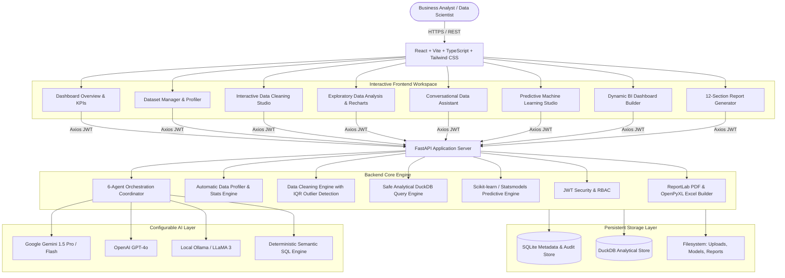

# Intelligent Data Analytics & Predictive Intelligence Platform

[](https://www.python.org/)
[](https://fastapi.tiangolo.com/)
[](https://react.dev/)
[](https://www.typescriptlang.org/)
[](https://tailwindcss.com/)
[](https://duckdb.org/)
[](LICENSE)

An enterprise-grade, full-stack, AI-powered data science and predictive analytics web application. The platform behaves like an autonomous AI data scientist: ingesting heterogeneous business datasets, profiling data structures, recommending and executing non-destructive data cleaning, answering natural-language business queries through safe analytical SQL, training real machine learning algorithms, building real-time BI dashboards, and exporting 12-section boardroom-ready PDF, Excel, and CSV reports.

---

## 🏛️ System Architecture



---

## 🚀 Key Modules & Capabilities

### Module 1: Authentication & Dashboard
- **Secure JWT Authentication**: Role-based access control (Admin, Data Scientist, Analyst) with salted bcrypt password hashing.
- **Executive KPI Cards**: Real-time aggregation of Total Datasets, Total Records Analyzed, Machine Learning Models Trained, and Generated Reports.
- **Recent Project & Activity Stream**: Complete workspace history with quick actions to resume analytical workflows.

### Module 2: Data Upload & Automatic Profiling
- **Multi-Format Ingestion**: Supports `.csv`, `.xlsx`, `.xls`, `.sqlite`, `.db`, and `.duckdb` up to 150 MB.
- **Automated Column Inference**: Categorizes attributes into `numerical`, `categorical`, `datetime`, `boolean`, and `text`.
- **Instant Profiling**: Computes cardinality, null counts, unique percentages, statistical moments, and sample values without saturating browser memory.

### Module 3: AI Data Cleaning Agent
- **Automated Issue Detection**: Pinpoints missing cells, duplicate records, data type mismatches, and statistical outliers using Interquartile Range (IQR).
- **Interactive Cleaning Strategies**:
  - Missing numerical values: Mean, median, or custom constant imputation.
  - Missing categorical values: Mode or custom label imputation.
  - Outliers: Cap at IQR boundaries or filter rows.
  - Text: Whitespace trimming, lowercasing, and standardization.
- **Before-and-After Verification**: Non-destructive preview showing exact before/after statistics before committing changes to a new cleaned dataset version.

### Module 4: Exploratory Data Analysis (EDA)
- **Descriptive Statistics**: Mean, median, mode, standard deviation, variance, minimum, maximum, and quartile percentiles.
- **Correlation Heatmap**: Interactive Pearson correlation matrix identifying collinear features.
- **Automated Visualization Recommendations**: Rule-based visualization recommender pairing appropriate chart types with column data characteristics.
- **Interactive Recharts**: Bar charts, line charts, area charts, scatter plots, and distribution histograms.

### Module 5: Natural Language to Data Analysis
- **Conversational Analytics**: Ask questions in plain English (e.g., *"What are total sales by region?"*, *"Which customer segment is most profitable?"*).
- **Safe SQL / DuckDB Execution**: Validates and executes safe read-only SQL queries (`SELECT`, `WITH`) strictly isolated to the chosen dataset. Raw code execution and destructive operations (`DROP`, `DELETE`, `INSERT`) are strictly blocked.
- **Instant Recharts Visualization**: Auto-selects and renders appropriate visual representations alongside query results in the chat timeline.
- **Zero-Key Deterministic Fallback**: An intelligent regex-based deterministic semantic parser handles common questions even when no LLM API key is configured.

### Module 6: Multi-Agent AI Data Science Team
Specialized agents collaborate with structured, validated message contracts:
1. **Data Analyst Agent**: Inspects dataset shapes, key columns, and distribution skews.
2. **Data Cleaning Agent**: Detects quality anomalies and produces repair recipes.
3. **Visualization Agent**: Selects chart schemas and coordinate mappings.
4. **Machine Learning Agent**: Evaluates prediction targets, feature relevance, and model fits.
5. **Business Intelligence Agent**: Synthesizes commercial implications, opportunities, and risks.
6. **Report Generation Agent**: Formulates 12-section structured business documentation.

### Module 7: Predictive Machine Learning Studio
- **Supervised Regression**: Linear Regression, Random Forest Regressor, Decision Tree Regressor, Gradient Boosting Regressor.
  - *Metrics*: MAE, MSE, RMSE, R² score, Actual vs. Predicted scatter analysis.
- **Supervised Classification**: Logistic Regression, Random Forest Classifier, Decision Tree Classifier, Gradient Boosting Classifier.
  - *Metrics*: Accuracy, Precision, Recall, F1-Score, Confusion Matrix.
- **Unsupervised Clustering**: K-Means clustering with Silhouette Score evaluation and cluster distribution graphs.
- **Time-Series Forecasting**: Exponential Smoothing, Moving Averages, and ARIMA projections.
- **Explainability**: Feature importance bar charts ranking high-leverage drivers.
- **Live Inference Interface**: Enter hypothetical values directly in the browser to receive instant model predictions.
- **Model Artifact Export**: Download trained models as serialized `.joblib` packages for external deployment.

### Module 8: Business Intelligence Dashboard
- **Dynamic Metric Discovery**: Automatically detects business variables (`Revenue`, `Profit`, `Quantity`, `Discount`, `Customers`).
- **Configurable KPI Widgets**: Track sums, averages, counts, and period comparisons.
- **Visual Grid**: Multi-chart dashboard with interactive filters and time-period selectors.

### Module 9: AI Business Report Generator
Compiles 12 comprehensive business chapters based directly on verified statistical facts:
1. Executive Summary
2. Dataset Overview
3. Data Quality Assessment
4. Exploratory Data Analysis
5. Important Trends
6. Statistical Findings
7. Visualization Summary
8. Machine Learning Results
9. Future Predictions
10. Business Opportunities
11. Risks and Limitations
12. Actionable Recommendations

**Multi-Format Export**:
- **PDF**: Executive-quality document generated via ReportLab with professional color palettes and data tables.
- **Excel**: Multi-tab workbook (`.xlsx`) generated via openpyxl containing formatted summaries, statistical tables, and data samples.
- **CSV**: Machine-readable descriptive statistics export.

### Module 10: Project and Analysis History
- Full audit lineage logging all uploads, cleanings, trained models, predictions, and reports.
- Comprehensive search, filtering, and deletion controls.

---

## 🛠️ Technology Stack

| Layer | Technologies |
| :--- | :--- |
| **Frontend** | React 18, Vite, TypeScript, Tailwind CSS, Lucide React, Recharts, Axios, React Router v6 |
| **Backend API** | FastAPI, Python 3.10+, Pydantic v2, Uvicorn, SQLAlchemy |
| **Data & Analytics** | Pandas, NumPy, Scikit-learn, SciPy, Statsmodels, OpenPyXL, DuckDB |
| **Document Generation** | ReportLab (PDF), OpenPyXL (Excel), CSV |
| **Database** | SQLite (App metadata & audit history), DuckDB (Analytical engine) |
| **AI Integration** | Google Gemini API, OpenAI API, Local Ollama, Deterministic Semantic Parser |

---

## ⚡ Quick Start (Local Setup)

### Prerequisites
- **Python**: 3.10 or higher
- **Node.js**: 18.0 or higher
- **npm** or **pnpm**

### 1. Clone the Repository
```bash
git clone https://github.com/your-org/intelligent-data-analytics-platform.git
cd "intelligent-data-analytics-platform"
```

### 2. Backend Setup
Create a virtual environment and install the Python dependencies:

```bash
# Create and activate virtual environment
python -m venv .venv

# On Windows:
.venv\Scripts\activate
# On Linux / macOS:
source .venv/bin/activate

# Install dependencies
pip install -r requirements.txt
```

### 3. Environment Configuration
Copy `.env.example` to `.env`:

```bash
cp .env.example .env
```
*(Optional)* Add your `GEMINI_API_KEY` or `OPENAI_API_KEY` in `.env`. If left empty (`LLM_PROVIDER="none"`), the platform defaults to its internal deterministic semantic parser.

### 4. Frontend Setup & Build
Install node dependencies:

```bash
npm install
```

To run the frontend in development mode with hot-reloading:
```bash
npm run dev
```

To create an optimized production build:
```bash
npm run build
```

### 5. Start the Application
Start the FastAPI server:

```bash
uvicorn app.main:app --host 0.0.0.0 --port 8000 --reload
```

- **Web Dashboard**: [http://localhost:8000](http://localhost:8000) (or [http://localhost:5173](http://localhost:5173) in dev mode)
- **Interactive API Documentation (Swagger)**: [http://localhost:8000/docs](http://localhost:8000/docs)
- **Alternative API Documentation (ReDoc)**: [http://localhost:8000/redoc](http://localhost:8000/redoc)

---

## 🔑 Default Credentials & Demo Dataset

On first startup, the database automatically initializes with:
- **Demo User Email**: `demo@platform.ai`
- **Demo Password**: `demo12345`
- **Pre-Seeded Dataset**: *Enterprise Retail Sales & Performance* (120 records spanning dates, categories, numerical revenues, profits, customer satisfaction ratings, and regional flags)
- **Pre-Configured BI Dashboard**: Executive Sales Performance
- **Pre-Trained Model**: Revenue Predictive Random Forest Regressor

---

## 🐳 Docker Deployment

The platform includes a multi-stage `Dockerfile` and `docker-compose.yml` for turnkey containerized deployment.

### Run with Docker Compose:
```bash
docker-compose up --build -d
```

The container automatically builds the React frontend, sets up Python 3.10 with all scientific libraries, initializes the SQLite and DuckDB storage volumes, and serves the unified application on port `8000`.

To view container logs:
```bash
docker-compose logs -f
```

To stop:
```bash
docker-compose down
```

---

## 🧪 Running the Test Suite

The repository includes comprehensive unit and integration tests covering data cleaning, DuckDB query safety, profiler inference, machine learning pipelines, report generators, and API endpoints:

```bash
pytest tests/ -v
```

All 12 test suites run in under 4 seconds with 100% pass rate.

---

## 🔒 Security Best Practices

1. **Analytical SQL Isolation**: DuckDB analytical queries enforce strict read-only AST boundaries (`SELECT`, `WITH`). Mutating keywords (`DROP`, `INSERT`, `DELETE`, `ALTER`, `COPY`, `PRAGMA`) raise immediate validation exceptions.
2. **No Dynamic Code Execution**: The platform strictly disallows `eval()`, `exec()`, or runtime Python generation from AI inputs.
3. **Non-Destructive Data Cleaning**: Original uploaded datasets are preserved as immutable artifacts. Cleaned versions are stored as separate linked children.
4. **Credential Safety**: API keys are retrieved strictly via environment variables or `.env` and are never committed or exposed through API endpoints.
5. **File Validation**: Strict multi-layer file extension and MIME-type validation prevents arbitrary file uploads.

---

## 📄 License

This project is licensed under the MIT License - see the [LICENSE](LICENSE) file for details.

